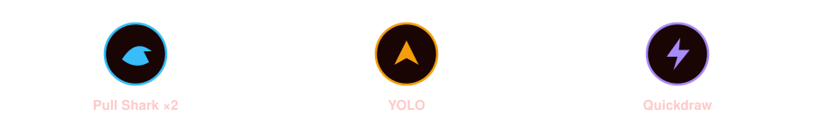

  
  
  

## 👋 Hello, I'm Wis

I turn ideas into polished, useful, and memorable digital experiences. My work blends frontend craft, full-stack problem solving, playful interaction, and clean visual direction.

- 🎓 Studying and building at **Suranaree University of Technology**
- 🚀 Creating web projects that feel friendly, fast, and purposeful
- 🧩 Into product thinking, UI details, and creative technology
- 🌌 Learning by shipping real projects and experimenting
- 🤝 Open to collaboration, feedback, and interesting challenges

## 🧭 What I build

| Focus | What it means |
| :--- | :--- |
| 🖱️ **Interactive web** | Responsive interfaces with thoughtful motion and clear user journeys |
| 🧱 **Full-stack products** | Frontend experiences connected to practical data and application logic |
| 🧪 **Creative experiments** | Small prototypes and playful projects that make tech feel alive |
| 📚 **Continuous learning** | Better patterns, cleaner code, stronger product decisions |

## 🛠️ Toolkit

  

Static badges

  
  
  
  
  
  
  
  

## ✨ Selected work

  
  

  
  

  
  

  
  

## 🏆 Achievements

## 📊 GitHub overview

  

  <picture>
    <source media="(prefers-color-scheme: dark)" srcset="https://raw.githubusercontent.com/wisHReborn/wisHReborn/output/github-snake-dark.svg" />
    
  </picture>

## 🌱 Currently growing

- 🏗️ Building complete full-stack projects, from idea to deployment
- 🧼 Improving component architecture and maintainable TypeScript
- ♿ Practicing accessible, responsive, intentional UI design
- 🔍 Letting small details make a stronger product experience

## 💬 Let's connect

If you enjoy building things, exploring new ideas, or making the web a little more human, feel free to reach out. I'm always happy to meet people who care about craft, curiosity, and useful technology.

  <a href="https://github.com/wisHReborn">GitHub</a> ·
  <a href="https://www.instagram.com/reb0rn_606/">Instagram</a>

